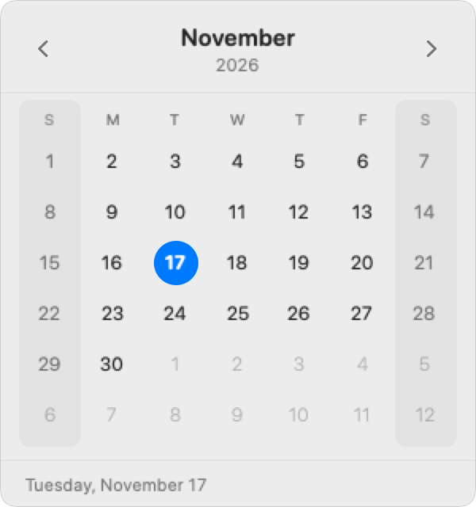
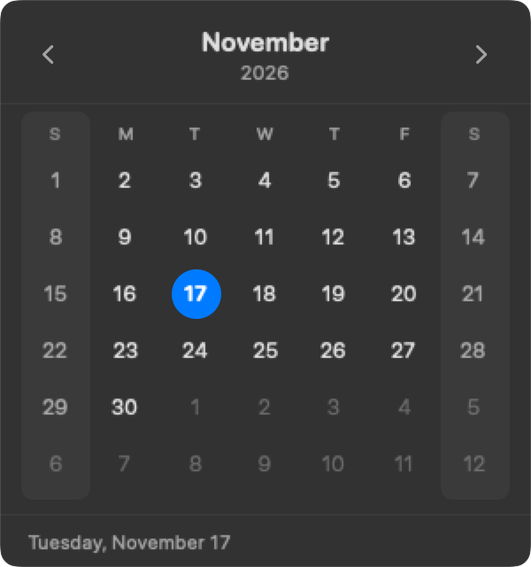

# PopCal 🗓️

[](https://github.com/briandealwis/PopCal/actions/workflows/test.yml)

A lightweight macOS menubar calendar app. Lives in your system tray, shows the current month in a clean popover, and stays out of your way.

<p align="center">
  
  &nbsp;
  
</p>

## Features

- **Menubar icon** — click to show/hide the calendar popover
- **Global hotkey** — configurable keyboard shortcut (default: ⌥⌘C) to summon the calendar from anywhere
- **Infinite scrolling** — scroll with two fingers on the trackpad (or a mouse wheel, or click-drag) to move continuously through the weeks; the chevron buttons jump a month at a time
- **Keyboard navigation** — arrow keys select a day, Return opens it, T jumps to today, N/P change month, Esc closes
- **Weekend shading** — weekend columns are subtly greyed out
- **Open a day** — click any day to open it in the Calendar app (default) or Google Calendar in your browser, chosen in Settings. The first time PopCal opens the Calendar app, macOS asks for permission to control it.
- **Today highlighting** — today's date is always clearly marked with your accent color
- **Configurable week start** — choose Sunday or Monday as the first day of the week
- **Settings** — right-click or ⌘-click the menubar icon to access settings
- **Dark/Light mode** — respects your system appearance

## Requirements

- macOS 13.0 (Ventura) or later
- Xcode 15 or later

## Setup

### 1. Open in Xcode

```bash
open PopCal.xcodeproj
```

### 2. Configure Signing

In Xcode:
- Select the **PopCal** target
- Go to **Signing & Capabilities**
- Set your **Team** to your Apple Developer account (or use Personal Team for local builds)

### 3. Build & Run

Press **⌘R** in Xcode. The app will appear in your menubar — no Dock icon.

### Building from the command line

```bash
./build.sh            # Release build → build/PopCal.app
./build.sh run        # Debug build and launch
./build.sh test       # Run unit tests
./build.sh screenshots  # Regenerate docs/screenshots/*.png
./build.sh install    # Release build, copied to ~/Applications
./build.sh dist       # Release build, zipped to build/PopCal-<version>.zip
./build.sh clean
```

Builds are ad-hoc signed by default. To sign with your developer identity, set `DEVELOPMENT_TEAM=<your team ID>`.

### 4. (Optional) Launch at Login

To have PopCal start automatically:
- Open **System Settings → General → Login Items**
- Add PopCal to the list

---

## Usage

| Action | Result |
|--------|--------|
| Click menubar icon | Show/hide calendar popover |
| Right-click or ⌘-click icon | Open context menu |
| Two-finger scroll / mouse wheel / drag | Scroll through weeks |
| Click chevrons | Navigate months |
| Click a day | Open that day in Calendar or Google Calendar |
| ← → ↑ ↓ | Select a day (by day / by week) |
| Return | Open the selected day (or today) |
| T | Go to today |
| N / P | Next / previous month |
| Esc | Close the calendar |
| Click "Today" (footer) | Jump back to current month |
| Global hotkey (default ⌥⌘C) | Show calendar from anywhere |

## Settings

Open Settings via the context menu (right-click or ⌘-click the menubar icon):

- **Week starts on** — Sunday or Monday
- **Enable hotkey** — toggle the global shortcut on/off
- **Shortcut** — click "Record" and press any key combination to set a new hotkey

## Architecture

```
PopCal/
├── PopCalApp.swift        — App entry point (@main)
├── AppDelegate.swift      — Menubar icon, popover, hotkey registration
├── AppPreferences.swift   — UserDefaults-backed settings (ObservableObject)
├── CalendarView.swift     — Main calendar UI with swipe navigation
├── SettingsView.swift     — Settings window
└── Info.plist             — LSUIElement=true (no Dock icon)
```

## Customization

### Changing the default hotkey

Edit `AppPreferences.swift`:
```swift
static let defaultHotkeyKeyCode = 8 // C
static let defaultHotkeyModifiers: NSEvent.ModifierFlags = [.command, .option]
```

Common key codes: `Space=49`, `Return=36`, letters A-Z use the key codes in `keyCodeToString()`.

### Changing the popover size

Edit `AppDelegate.swift`:
```swift
popover?.contentSize = NSSize(width: 300, height: 320)
```

And `CalendarView.swift`:
```swift
.frame(width: 300, height: 320)
```

---

## Notes

- The app uses `LSUIElement = true` to hide from the Dock
- Sandboxing is disabled (required for global hotkeys via Carbon `RegisterEventHotKey`)
- Settings are persisted via `UserDefaults`
- The global hotkey uses the Carbon Event Manager API, which requires a non-sandboxed app
